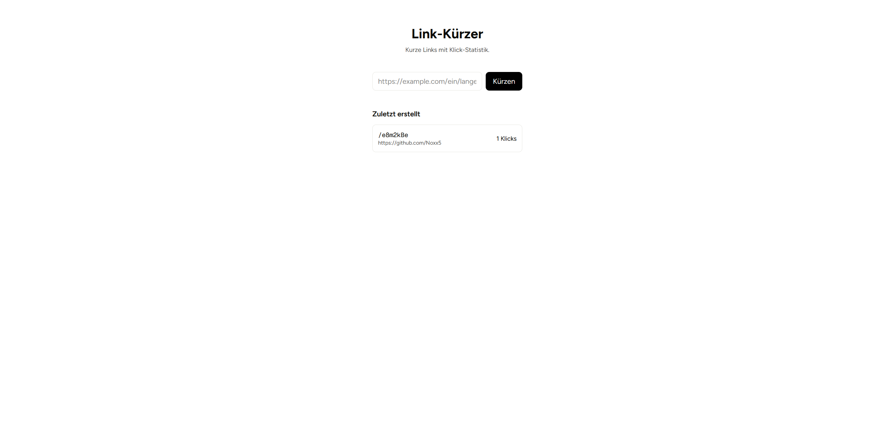

# Link Shortener

[](https://github.com/Noxx5/link_shortener/actions/workflows/ci.yml)

Shorten long URLs and track clicks. Built with Next.js, Prisma and PostgreSQL, covered by unit, integration and end-to-end tests.

**Live demo:** <https://link-shortener-alpha-lovat.vercel.app/>



## Features

- Shorten http(s) URLs to 7-character codes without ambiguous characters
- Click tracking that runs after the redirect, so redirects stay fast
- Validation with Zod: only http/https, maximum length, no links to the app itself
- Expired links return `410 Gone`, unknown codes `404`
- Latest links with click counts, streamed with Suspense

## Tech stack

Next.js (App Router, Server Actions, Route Handlers) · TypeScript · Tailwind CSS · Prisma · PostgreSQL · Zod · Vitest · Playwright · GitHub Actions · Vercel

## Getting started

Requirements: Node.js 20.19+ and a PostgreSQL database (for example a free Neon project or a local installation).

```bash
git clone https://github.com/Noxx5/link_shortener.git
cd REPO
npm install
```

Copy `.env.example` to `.env` and fill in `DATABASE_URL` and `BASE_URL`, then:

```bash
npx prisma migrate dev
npm run dev
```

## Tests

| Command | What it runs |
| --- | --- |
| `npm test` | Unit tests (code generation, URL validation) |
| `npm run test:int` | Integration tests against a real test database |
| `npm run test:e2e` | End-to-end tests in a browser (Playwright) |

Integration and E2E tests need a separate database configured in `.env.test` (see `.env.test.example`). They only run when `ALLOW_DB_RESET=true` is set, so they can never wipe a real database by accident.

## Design decisions

- **307 instead of 301:** permanent redirects get cached by browsers, which would make later clicks impossible to count.
- **`after()` for click tracking:** the click is stored after the response is sent, so a slow database never slows down a redirect.
- **Logic outside the Server Action:** `createLink` lives in `src/lib/links.ts` and is tested directly against the database, including code collisions.
- **E2E against the production build:** catches rendering problems that the dev server hides.

## License

MIT
